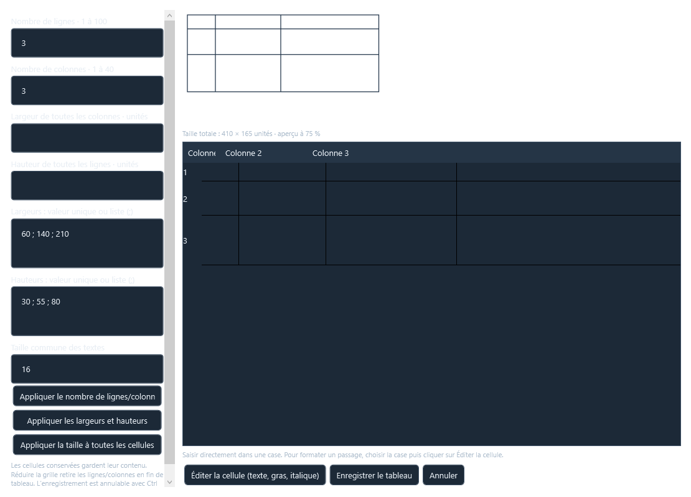

# GeMMeElec 0.22.1 — correction des dimensions de tableau

La version 0.22 ignorait les champs simples de largeur/hauteur lorsqu’on cliquait sur **Appliquer les largeurs et hauteurs** : ils servaient uniquement aux nouvelles lignes/colonnes, alors que le bouton lisait les listes détaillées. La grille de saisie affichait en outre des colonnes bornées entre 90 et 300 unités et des lignes de hauteur constante. L’aperçu s’ajustait automatiquement à sa fenêtre, ce qui pouvait masquer un changement de taille.

## Dans la fenêtre du tableau

- **Largeur de toutes les colonnes** et **Hauteur de toutes les lignes** s’appliquent maintenant aux cellules existantes.
- Les champs de listes acceptent soit une valeur commune (`80`), soit une valeur par colonne/ligne (`60 ; 140 ; 210`). Le dernier champ modifié définit le choix de l’utilisateur.
- **Appliquer les largeurs et hauteurs** actualise la grille : les colonnes et les lignes reflètent les valeurs saisies. La largeur d’une colonne déplacée dans la grille est également conservée à l’enregistrement.
- L’aperçu reste à 75 %, avec défilement si nécessaire, et un libellé indique la taille totale réelle du tableau.
- **Enregistrer le tableau** conserve les nouvelles tailles en une action annulable. **Annuler** conserve le folio avant ouverture du dialogue.

## Dans Propriétés

Les champs **Largeur totale du tableau** et **Hauteur totale du tableau** règlent ses dimensions globales, en unités ou en pourcentages. Ils adaptent proportionnellement les cellules. Le groupe **Dimensions communes des cellules** règle séparément la largeur de toutes les colonnes et la hauteur de toutes les lignes, en unités de dessin.

Pour ces champs, terminer la saisie puis appuyer sur **Entrée**, ou quitter le champ, pour appliquer. Les chiffres intermédiaires ne modifient plus le tableau. **Échap** restaure la valeur précédente. Les tailles totales et les tailles communes se synchronisent après validation ; Ctrl+S valide la saisie avant sauvegarde. Une valeur invalide laisse le projet intact et affiche une erreur sous le champ.

Chaque cellule conserve une dimension minimale de 8 unités ; un tableau doit rester dans la page. Le contenu, les passages en gras/italique, la copie, les exports et le format projet **10** sont conservés.

## Vérifications

Le défaut a été reproduit par un test d’interface qui échouait dans la version précédente. Les vérifications supplémentaires couvrent les tailles communes/individuelles, leur affichage, le déplacement de colonne, les saisies numériques et en %, les erreurs intermédiaires, l’annulation et la sauvegarde/relecture. Les mesures sont consignées dans `MESURES_0.22.1.json`.

**201 tests applicatifs et 166 contrôles MCP passent** sur le binaire publié, avec 97 outils. Compilation sans erreur ni avertissement. La copie du projet utilisateur est sauvegardée/relue pour vérifier la compatibilité ; son original est conservé.

Les mesures de glisser et zoom restent proches de la version 0.22 : sur le folio dense de 400 composants dans un projet de 5 000, préparation moyenne d’environ 0,95 ms pour déplacer un texte, 5,62 ms pour déplacer un symbole et 0,14 ms pour le zoom. Le tableau 8 × 6 de référence se déplace en environ 1,26 ms par image préparée. Ces mesures hors écran excluent la rasterisation GPU.

La version 0.22.1 est installée dans `build/GeMMeElec.exe`, après vérification que l’application était fermée. L’ancienne version est conservée en sauvegarde. Le contrôle de démarrage du binaire installé confirme la version 0.22.1, le format 10 et les 97 outils. SHA256 : `49B62E13333CB7FF12152FDF321C85F9EFF9AE0DDF3DC822CF769094A45870C3`.

