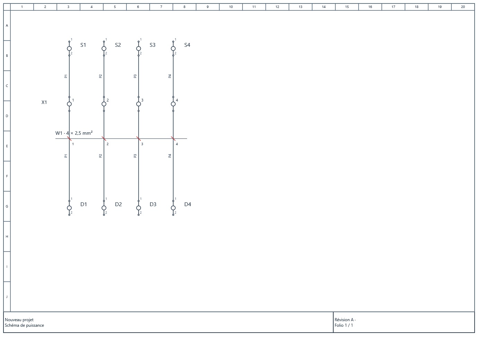

# GeMMeElec 0.19 — circuits, borniers, câbles et projets

Cette version réalise la sélection **19, 21, 24, 25, 26, 27 et 28**, ainsi que les deux gestes montrés entre 15 et 19 secondes dans la vidéo fournie. La section en mm² a été confirmée dans la conversation.

## Les deux gestes de la vidéo

Dans l’interface à ruban, utiliser l’onglet **Circuits**. Dans l’interface compacte, utiliser le menu **Insérer**.

1. Choisir **Tracer une ligne de bornes**. Cliquer le premier point puis le second point d’une ligne traversant les fils. L’aperçu indique les intersections. Saisir le repère du bornier, le premier numéro et le niveau, puis **Créer en une action**. Chaque fil reçoit une borne de passage raccordée ; son numéro est conservé de part et d’autre.
2. Choisir **Tracer une ligne de câble**. Tracer une seconde ligne traversant les conducteurs à regrouper. Saisir le repère du câble, la section commune en mm² et éventuellement son type. Par exemple, quatre conducteurs et une section de 2,5 donnent **W1 · 4 × 2,5 mm²**. Laisser la section vide lorsqu’elle est inconnue.

La ligne de câble est une annotation de regroupement : elle ne crée aucune liaison électrique entre les conducteurs. Les chiffres auprès des traits obliques représentent les conducteurs du câble. Les numéros des fils restent inchangés. Une scission du fil conserve son câble et son conducteur. **Projet → Câbles et sections** modifie les données communes ; la propriété du fil permet aussi une section individuelle.

**Échap** annule un geste commencé. **Ctrl+Z** annule toutes les insertions d’une ligne en une seule action. Les sections sont des données saisies ; le logiciel ne calcule pas le dimensionnement électrique.

## 19 — routage des conducteurs

Sélectionner les fils puis **Projet → Router les fils sélectionnés**, ou **clic droit → Routage intelligent**. Le moteur cherche un parcours orthogonal autour des appareils, textes et notes, avec un coût pour les coudes et les croisements. Les extrémités restent attachées aux ports.

Les fils ainsi routés sont recalculés quand la géométrie du folio change. Une édition manuelle des segments ou des points de passage rend le parcours manuel. Si une modification empêche le recalcul, le parcours précédent est conservé et une anomalie de routage est signalée. La commande explicite refuse une opération impossible sans appliquer une partie des changements.

La recherche est bornée : elle ne garantit pas un résultat optimal pour toute densité de dessin. En cas d’échec, déplacer les obstacles ou utiliser les points de passage.

## 21 — vues graphiques des borniers

Dans **Projet → Borniers et plans de raccordement**, cocher **Vue graphique et tableau détaillé**, puis générer les folios. Les vues montrent les positions, niveaux, ports, raccordements et pontages déclarés. Les tableaux suivants conservent les raccordements et commentaires complets.

Une vue contient jusqu’à douze positions et quatre niveaux. Les niveaux supplémentaires et les grandes séries produisent d’autres pages. Un pont vers une autre page est signalé. Après modification des affectations ou pontages, régénérer les plans. Ces folios restent liés au gestionnaire du bornier.

## 24 et 25 — réutilisation et insertion

**Créer un bloc depuis la sélection** se trouve dans **Insérer**, dans le ruban **Circuits** et au clic droit. Sélectionner les symboles du circuit et ses notes ; les fils dont les deux extrémités appartiennent à la sélection sont inclus automatiquement. Le fichier **.gemblock** contient les copies de symboles nécessaires, fils, câbles et affectations de bornier. Les raccordements extérieurs sont détachés et leur nombre est indiqué. Le bloc rejoint aussi la bibliothèque personnelle.

**Importer / placer un bloc** charge ce fichier, montre un aperçu et demande de cliquer son coin supérieur gauche. La copie reçoit de nouveaux identifiants et repères, conserve les associations internes et ne dépend plus de son fichier source. **Ctrl+Z** retire l’insertion entière. Placer le bloc complètement dans la zone de dessin.

Pour **insérer un symbole sur un fil**, sélectionner un fil, choisir la commande dans **Insérer** ou au clic droit, choisir le symbole et ses deux ports, puis cliquer la position sur le fil. Le symbole doit tenir dans le segment sans recouvrir un appareil. Une borne de passage conserve le numéro ; un appareil sans continuité déclarée reçoit un nouveau numéro en sortie. Les numéros indépendants et les styles particuliers sont conservés.

## 26 — plusieurs projets dans la même fenêtre

**Nouveau**, **Ouvrir**, un gabarit, une conversion ou une récupération ouvrent un onglet supplémentaire. Chaque onglet conserve ses folios, modifications, historique, sélection, zoom et réglages de lecture. Les boutons Annuler/Rétablir agissent sur le projet actif. Ouvrir un fichier déjà présent active son onglet.

Le bouton **×** ferme un projet ; un projet modifié propose son enregistrement. Quitter l’application vérifie chaque projet. Les copies automatiques couvrent les onglets modifiés. Un enregistrement sur le fichier d’un autre onglet est refusé pour protéger son travail. La limite est de dix projets ouverts ; la consommation mémoire dépend de leur taille.

Les outils MCP historiques `project_new` et `project_open` conservent leur comportement de remplacement du projet actif, avec contrôle des modifications non enregistrées. Les outils `project_tab_*` permettent de travailler explicitement avec les onglets.

## 27 — favoris et bibliothèque personnelle

**Clic droit sur un symbole de la bibliothèque ou du schéma → Ajouter aux favoris**. Retrouver les favoris et circuits dans le panneau **Bibliothèque → Favoris et circuits**. La recherche couvre les noms, catégories et mots-clés ; le filtre de famille affiche les catégories personnelles.

**Insérer → Bibliothèque personnelle** permet de modifier les noms, catégories et mots-clés, supprimer une entrée ou exporter un bloc. Les favoris restent disponibles hors ligne, dans le dossier local **GeMMeElec-library**. Une suppression de favori ne supprime pas les objets déjà placés. Les symboles personnels sont copiés dans le projet ; la bibliothèque intégrée reste inchangée.

## 28 — lecture du schéma

**Affichage → Cadrer la sélection** ajuste la vue aux objets choisis. **Affichage → Lecture et détails** règle la taille des textes de 50 à 200 %, et masque ou affiche caractéristiques, descriptions, références, numéros de ports, numéros de conducteurs et notes.

Ces réglages appartiennent à la vue de l’onglet pendant la session. Ils ne changent pas les données du projet ni les textes exportés en PDF/SVG. La sélection et le déplacement des textes utilisent leurs dimensions affichées.

## Vérifications et compatibilité

Le projet utilise le format **8**. Les versions 1 à 7 sont migrées à la lecture ; aucune écriture du fichier source n’est implicite. La version 0.18 ne lit pas le format 8 : conserver une copie d’un projet avant son premier enregistrement dans cette version si un retour à 0.18 est nécessaire.

Le rapport de livraison associé contient les résultats des tests de l’application, des outils MCP et des mesures de charge. Les tests travaillent dans un hôte isolé. Le document LaserSieve original est conservé octet pour octet. La démonstration dans l’application ouverte n’a pas été reprise.

Les vues graphiques restent des plans génériques : aucune référence fabricant, cote physique ou conformité EPLAN native n’est déduite de la vidéo.
