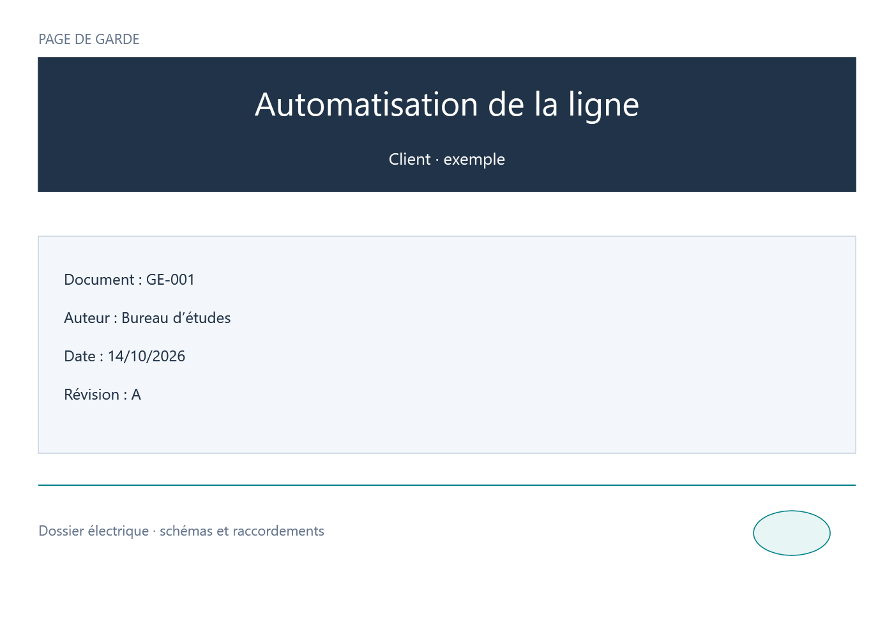

# GeMMeElec 0.20 — pages de garde et dessins libres

## Définir une page de garde

Pour un folio existant, ouvrir **Folio → Propriétés du folio**, puis choisir **Page de garde** dans **Type de folio**. Ses composants, fils et textes sont conservés. Le cadre de repérage et les lettres/numéros de zones disparaissent. Les réglages de lignes/colonnes du projet restent disponibles pour les schémas.

Une page de garde est **sans cartouche par défaut**, selon le choix confirmé dans la conversation. Le sélecteur **Cartouche affecté à ce folio** permet d’en afficher un si nécessaire. Celui-ci ne réactive pas le repérage lignes/colonnes. Les plans de bornier, d’armoire et de nomenclature générés conservent leur type et ne peuvent pas être convertis.

**Folio → Ajouter une page de garde** crée une nouvelle page en début du projet, en une action annulable. Le préfixe **PG** dans la liste des folios indique son type. Les commandes Monter/Descendre permettent ensuite de changer son ordre.

## Composer le contenu

Les commandes se trouvent dans **Insérer** et dans le ruban **Mise en page**. Elles sont aussi utilisables sur les schémas ordinaires.

- **Texte** : cliquer la position, saisir le texte et choisir taille et couleur. Plusieurs lignes sont possibles. Le panneau Propriétés règle aussi l’angle et l’alignement.
- **Rectangle / Ellipse / Ligne libres** : glisser entre les deux points, ou cliquer successivement les deux coins/extrémités. Échap annule le geste commencé.
- **Logo / image** : choisir le fichier puis cliquer sa position. Le dessin est enregistré dans le projet, sans dépendre ensuite du fichier source.

Déplacer les objets avec la souris ; utiliser les poignées des formes pour les redimensionner. Pour une forme sans fond, sélectionner son contour. Le panneau Propriétés donne accès aux coordonnées, dimensions, couleur du trait, fond facultatif, épaisseur et type de trait. Dupliquer, supprimer, aligner, répartir et cadrer la sélection restent disponibles. **Ctrl+Z / Ctrl+Y** annulent et rétablissent les opérations.

Une ligne libre est un dessin graphique : elle ne crée aucune connexion électrique. Pour câbler des symboles, continuer à utiliser **Conducteur**.

## Textes liés aux informations du projet

Cocher **Texte lié aux champs du projet**, puis utiliser par exemple :

| Champ | Valeur affichée |
| --- | --- |
| `{project.title}` | Nom du projet |
| `{project.customer}` | Client / société |
| `{project.documentNumber}` | Référence documentaire |
| `{project.author}` | Auteur |
| `{project.date}` | Date saisie dans le projet |
| `{project.revision}` | Révision |
| `{sheet.title}` | Titre du folio |

Modifier les informations du projet actualise ces textes à l’écran et dans les exports. La case reste décochée par défaut pour conserver les textes contenant des accolades littérales.

## Sauvegarde et exports

Les formes et styles sont enregistrés dans le format projet **9**. Les versions 1 à 8 sont migrées à la lecture avec des schémas ordinaires et les anciens styles de texte inchangés. Les anciens exécutables ne lisent pas le format 9 ; conserver une copie du fichier avant son premier enregistrement dans cette version pour permettre un retour à une version antérieure.

Les exports PDF et SVG prennent en compte les pages de garde, rectangles et ellipses avec fond, lignes, images et textes stylés. Dans le PDF, les pages de garde placées au début du projet précèdent le sommaire automatique. La grille de placement reste un outil de l’éditeur et ne s’imprime pas. Les gabarits de projet conservent le type de folio et peuvent inclure ou omettre son contenu. Les blocs réutilisables peuvent aussi contenir des formes et des textes.

L’import d’images utilise la chaîne existante de l’application : copie réduite et fond blanc enregistrés dans le projet. Les aperçus des gestes continuent à utiliser le dessin conservé en mémoire de la version 0.19.1.

## Vérifications de la livraison

**170 tests applicatifs et 145 contrôles MCP passent**, sur le binaire Windows x64 publié, avec 92 outils. Les essais couvrent les formats 1 à 8, la conversion du type de folio, le cartouche facultatif, les gestes, l’annulation, le redimensionnement, les gabarits/blocs, les images et les exports. Le projet utilisateur est relu sur une copie et son fichier original reste inchangé.

Les mesures d’interaction restent comparables à 0.19.1 : préparation des images de glisser et zoom inférieure à 4 ms en moyenne dans les cas testés (50/400 composants sur le folio, projet de 5 000 composants). Il s’agit du temps CPU hors rasterisation GPU, sans garantie de ce délai pour toute disposition.

SHA256 du binaire vérifié : `00C8C36AC63BD7DC2F237579FB6AE54DEA87F21E289DDA3D82F5671AAE52FF21`.
