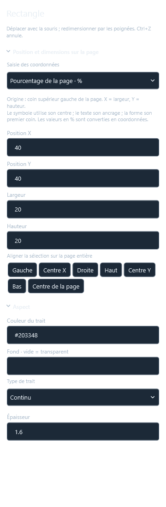

# GeMMeElec 0.21 — position sur la page et copier/coller

## Coordonnées numériques ou pourcentages

Sélectionner un symbole, un texte ou une forme, puis ouvrir **Propriétés → Position sur le folio / Position sur la page / Position et dimensions sur la page**. Le sélecteur **Saisie des coordonnées** propose les unités de dessin existantes ou les **pourcentages de la page**. Il reste dans le mode choisi lors des sélections suivantes dans la fenêtre.

L’origine est le coin supérieur gauche de la page entière, sans retrancher le cartouche ni la bande de repérage. X = 50 % correspond à la moitié de sa largeur, Y = 50 % à la moitié de sa hauteur. Sur une page de 1 400 × 990 unités, cela donne X = 700 et Y = 495. Une virgule ou un point décimal est accepté. Les coordonnées X/Y vont de 0 à 100 % ; les formes doivent rester entièrement dans la page.

Le point positionné est le centre du symbole, l’ancrage du texte, ou le premier coin/extrémité de la forme. Pour une forme, **Largeur** et **Hauteur** peuvent également être saisies en % de la largeur/hauteur de la page. Une ligne inverse conserve ses dimensions signées.

Changer le mode d’affichage ne modifie pas le projet. Saisir une valeur convertit celle-ci en coordonnées de dessin : ce n’est pas une contrainte permanente de redimensionnement de la page. Les symboles conservent leurs connexions ; chaque modification est annulable. Le format projet reste **9**.

## Aligner sur la page

Les boutons **Gauche, Centre X, Droite, Haut, Centre Y, Bas, Centre de la page** se trouvent sous les coordonnées et dans les propriétés d’une sélection multiple. Ils placent les limites du symbole, les limites visibles du texte (avec son angle), ou les limites de la forme sur les bords ou au centre de la page entière.

Un groupe se déplace en bloc, sans changer les écarts entre ses éléments. Les points de passage des fils internes suivent le groupe. **Centre de la page** centre la sélection entière, alors que X/Y = 50 % place le point d’ancrage de l’objet. Les commandes **Aligner / répartir** entre objets restent disponibles séparément.

## Copier et coller les éléments

1. Sélectionner les objets, éventuellement par rectangle de sélection.
2. **Ctrl+C** copie la sélection dans le presse-papiers Windows.
3. Choisir le folio ou l’onglet projet destinataire, puis **Ctrl+V**.
4. Un aperçu suit la souris ; cliquer pour placer le coin supérieur gauche de la copie. **Échap** annule avant insertion.

Les commandes sont également disponibles dans **Édition**, le menu contextuel et le ruban **Mise en page**. **Ctrl+D** conserve sa duplication immédiate existante. Dans un champ de texte, Ctrl+C et Ctrl+V continuent de copier/coller du texte.

Symboles intégrés et personnels, textes stylés, rectangles, ellipses, lignes et logos sont pris en charge. Les images et définitions personnelles sont incluses dans la copie. Les fils dont les deux extrémités sont copiées sont conservés avec leurs points de passage, styles et affectations ; un fil sélectionné seul inclut ses deux symboles d’extrémité. Les liaisons vers des éléments restés dans le projet source sont détachées. Les nouveaux objets reçoivent de nouveaux identifiants et les nouveaux équipements leurs propres repères ; les affectations internes de borniers, câbles et fonctions associées sont remappées.

Le collage est une seule action **Ctrl+Z / Ctrl+Y**. Il fonctionne sur les schémas et les pages de garde ; les plans générés restent modifiables depuis leur gestionnaire. Le placement sur une page de garde utilise toute la page, y compris ses bords. Sur un schéma, la copie doit tenir dans la zone de dessin.

## Vérification

La livraison est vérifiée sur son exécutable Windows publié : **182 tests applicatifs et 153 contrôles MCP passent**, avec 94 outils, sans avertissement de compilation. Les tests d’interface utilisent un presse-papiers isolé en mémoire pour préserver le contenu du presse-papiers de l’utilisateur. Le projet utilisateur est relu et enregistré uniquement sur une copie de test.

L’aperçu de collage est dessiné une seule fois, conservé en mémoire pendant son déplacement, puis libéré après placement ou Échap. Les mesures de glisser/zoom et d’un aperçu de 400 composants sont consignées dans `MESURES_0.21.json`.

Les mesures de préparation WPF du folio dense (400 composants sur le folio, 5 000 dans le projet) donnent environ 0,61 ms par image pour un texte déplacé, 4,05 ms pour un symbole et 0,10 ms pour le zoom. L’aperçu de collage de 400 composants est préparé en environ 0,005 ms par déplacement une fois son dessin créé. Ces mesures hors écran n’incluent pas la rasterisation GPU.

Le binaire installé dans `build/GeMMeElec.exe` a été contrôlé après remplacement : démarrage isolé, version 0.21.0, format projet 9 et 94 outils MCP. SHA256 : `C27B0F5B1CED548F94B615F15B1DF4B5C00846D16A4D46FBE0FF29F376594961`.

