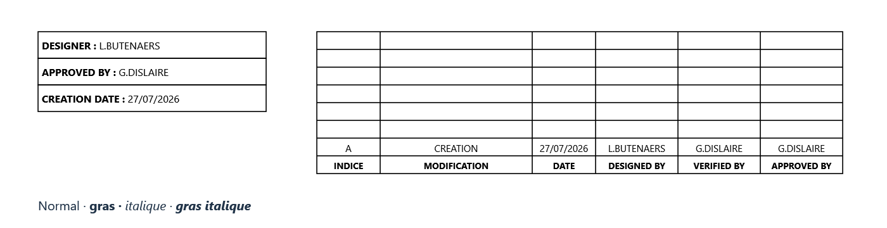

# GeMMeElec 0.22 — rectangles avec texte, tableaux et styles

Les réglages de dimensions ont été corrigés en [version 0.22.1](CORRECTION_TABLEAUX_0.22.1.md) : champs communs ou listes individuelles dans le dialogue, dimensions totales ou communes dans Propriétés, et validation des champs de dimensions avec Entrée ou changement de champ.

## Rectangle avec texte

Choisir **Insérer → Rectangle avec texte**, ou le bouton **Rectangle + texte** du ruban **Mise en page**. Dessiner le rectangle avec un glisser ou deux clics, puis saisir son contenu dans l’éditeur. Un rectangle libre existant peut également recevoir du texte depuis **Propriétés → Contenu → Écrire / formater le texte**.

Dans l’éditeur, sélectionner les mots à formater puis cliquer sur **Gras** ou **Italique**. Les raccourcis **Ctrl+B / Ctrl+I** sont également disponibles. Une même ligne peut contenir des passages normaux, gras, italiques ou gras italiques. **Tout sélectionner** permet de formater tout le contenu. Entrée ajoute une ligne. La taille, la couleur et les alignements horizontal et vertical sont réglables.

**Enregistrer le texte** applique le contenu ; **Annuler** conserve le contenu précédent. Le texte revient automatiquement à la ligne et reste limité au cadre. Agrandir le rectangle permet d’afficher davantage de contenu. Double-cliquer le rectangle ouvre à nouveau son éditeur.

## Tableau libre

Choisir **Insérer → Tableau**, ou **Mise en page → Tableau**. Le dialogue propose :

- le nombre de lignes et de colonnes ; **Appliquer le nombre de lignes/colonnes** actualise la grille ;
- la largeur de chaque colonne et la hauteur de chaque ligne, dans deux listes séparées par des points-virgules ;
- une taille de texte commune facultative, applicable à toutes les cellules ;
- la saisie directe dans chaque case de la grille et un aperçu du résultat.

Exemple : `100 ; 240 ; 100 ; 130 ; 130 ; 130` définit six colonnes de largeurs différentes. `30 ; 45 ; 60` définit trois lignes de hauteurs différentes. Les valeurs sont en unités de dessin, avec virgule ou point décimal. Le nombre de valeurs doit correspondre au nombre de colonnes/lignes.

Pour mélanger plusieurs styles dans une cellule, choisir sa case puis **Éditer la cellule (texte, gras, italique)**. Cet éditeur possède les mêmes fonctions que celui des rectangles, avec taille, couleur et alignements propres à la cellule. La saisie directe dans la grille convient au texte simple ; utiliser cet éditeur pour conserver ou modifier les passages formatés.

**Placer le tableau** prépare un aperçu : cliquer ensuite sur le folio pour l’insérer. Échap annule avant placement. Un tableau existant s’édite par double-clic, par le menu contextuel ou par **Propriétés → Modifier le tableau**. **Enregistrer le tableau** applique les changements en une seule action annulable.

Changer le nombre de lignes/colonnes conserve les cellules communes à l’ancienne et à la nouvelle grille. Une réduction retire celles situées au-delà des nouvelles limites ; Ctrl+Z permet de retrouver le tableau avant enregistrement. Limites : 100 lignes, 40 colonnes, 2 000 cellules par tableau, 20 000 par folio. Chaque largeur/hauteur est comprise entre 8 et 20 000 unités ; le tableau doit tenir dans la page.

## Gras et italique pour les textes existants

- **Texte libre** : cases Gras/Italique dans les propriétés ; **Formater une partie du texte** ouvre l’éditeur avancé.
- **Texte de symbole** : **Position des textes** propose Gras/Italique pour le repère, les caractéristiques, les descriptions, les bornes, les textes ajoutés et les destinations calculées des reports.
- **Numéro de conducteur** : les cases se trouvent dans **Position du numéro**.
- **Cartouche** : colonnes Gras/Italique dans son éditeur, plus **Formater le texte** pour les passages d’une cellule et les champs liés au projet.
- **Tous les textes du projet** : **Affichage → Présentation commune du schéma** propose **Gras pour tous les textes** et **Italique pour tous les textes**, avec aperçu avant application. Ces options couvrent aussi les repérages et les textes des plans générés ; les réglages individuels restent enregistrés.

Les deux styles sont indépendants : appliquer l’italique à un texte mixte conserve les passages en gras. La mise en forme des symboles ne modifie pas la bibliothèque d’origine.

## Position, copie et exports

Les rectangles avec texte et tableaux restent déplaçables, redimensionnables, alignables et copiables avec Ctrl+C/Ctrl+V, entre folios et projets. Les coordonnées numériques ou en % sont disponibles dans leurs propriétés. Le redimensionnement d’un tableau adapte proportionnellement ses colonnes et lignes. Les dessins libres ne créent aucune connexion électrique.

Le même dessin pilote l’écran, le SVG et le PDF. Les exports conservent les passages formatés, le retour à la ligne et les limites des cellules. Le PDF embarque les polices Segoe UI utilisées : normal, gras, italique et gras italique. Les textes restent recherchables et sélectionnables.

Le format projet passe à **10**. Les projets des formats 1 à 9 et les anciens blocs sont migrés à l’ouverture avec des textes normaux par défaut. Les anciennes versions du logiciel ne lisent pas le format 10 ; conserver une copie du fichier pour permettre un retour à une ancienne version.

## Aperçu de la référence

Le PDF correspondant est disponible dans `output/pdf/GeMMeElec_0.22_rectangles_tableaux.pdf`. Cet exemple est un projet de test séparé ; le projet utilisateur n’est pas modifié.

## Vérifications

**195 tests applicatifs et 166 contrôles MCP passent** sur l’exécutable Windows x64 publié, avec 97 outils. Compilation sans erreur ni avertissement. Les tests couvrent les styles partiels, les champs liés, les textes des symboles et conducteurs, les cellules/cartouches, les dimensions et les poignées, l’annulation, les anciens formats, les anciens blocs, la copie entre projets et le cache de dessin.

Le PDF de l’exemple a été rendu puis vérifié visuellement ; ses quatre polices sont embarquées et son texte reste extractible. Le projet utilisateur a été relu/enregistré uniquement sur une copie, avec empreinte originale inchangée. Les tests d’interface conservent le presse-papiers utilisateur.

Sur les données de charge (5 000 composants, 50/400 sur le folio actif), la préparation CPU des déplacements de textes est d’environ 1,1–1,2 ms par image ; celle d’un déplacement de symbole est d’environ 3,5–6,1 ms ; le zoom d’environ 0,11–0,16 ms. Le tableau de l’exemple (8 × 6 cellules) se déplace en environ 1,7 ms par image préparée. Les aperçus de placement/collage sont conservés en mémoire, avec des caches bornés. Les mesures hors écran excluent la rasterisation GPU ; les détails figurent dans `MESURES_0.22.json`.

SHA256 du binaire testé : `22CC764365D5EC441F1B4657DED1FC3AB910AD83FC91410EDB1093CBAF92FE74`.

La version 0.22 a été installée dans `C:\dev\QElectroTech_GeMMe\build\GeMMeElec.exe` après confirmation de l’enregistrement et de la fermeture de l’application. Le remplacement conserve une sauvegarde du binaire 0.21. Un démarrage isolé du binaire installé confirme la version 0.22.0, le format 10 et les 97 outils MCP.
